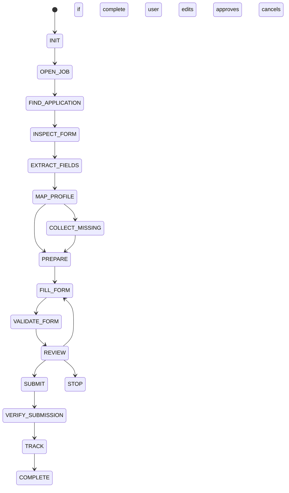

# Turio — Agent Architecture

## 1. Core idea

The Application Agent is a **state machine**, not a free-form chat loop.

```text
DISCOVER
→ INSPECT
→ EXTRACT
→ MAP
→ COLLECT
→ PREPARE
→ FILL
→ VALIDATE
→ REVIEW
→ SUBMIT
→ TRACK
```

## 2. State machine



## 3. Exact agent steps

### Step 1 — Initialize
Load:
- user id,
- selected job id,
- application adapter,
- verified profile.

### Step 2 — Open job/application
Navigate to the job/application URL.

### Step 3 — Inspect form
Identify:
- input fields,
- labels,
- required flags,
- file upload controls,
- select/radio/checkbox groups,
- custom questions.

### Step 4 — Normalize fields
Convert raw labels into canonical intents:

```text
"CV / Resume"
→ RESUME_UPLOAD

"Email address"
→ EMAIL

"Current city"
→ LOCATION

"Are you authorized..."
→ WORK_AUTHORIZATION
```

### Step 5 — Match against profile
For each required field:

```text
known verified value
→ use automatically
```

### Step 6 — Missing information
If required and absent:

```text
ask user
→ validate
→ save
→ continue
```

Do not ask again if already saved.

### Step 7 — Generative question
For open-ended questions:

```text
job + user profile + question
→ compact draft
→ user review
→ approved answer
```

### Step 8 — Fill
Use Browser Use to enter approved values and upload the original resume.

### Step 9 — Validate
Check:
- required fields filled,
- format accepted,
- uploads present,
- no accidental overwrites.

### Step 10 — Review
Show a final application summary.

### Step 11 — Submit
Only after explicit user approval.

### Step 12 — Verify and track
Record:
- timestamp,
- company,
- role,
- application URL,
- status,
- result evidence.

## 4. Bounded autonomy

The agent may autonomously:

- navigate,
- inspect,
- map,
- fill,
- upload,
- validate.

The agent must ask for user input for:

- missing factual personal data,
- ambiguous sensitive information,
- final submission approval,
- user edits.

## 5. Retry policy

Maximum retries per action are bounded.

Example:

```text
selector/action retry: 2
page refresh retry: 1
session restart: 1
```

Exact limits can be tuned after testing.

## 6. Agent memory

Use persistent memory only for:
- verified profile data,
- user-confirmed preferences,
- application answers that the user explicitly chooses to save.

Do not create uncontrolled long-term memory from website text.

## 7. Context minimization

Do not send the entire resume and entire webpage on every agent step.

Use compact context:

```text
user profile fields relevant to current form
+
current page/form structure
+
job summary if needed
```
