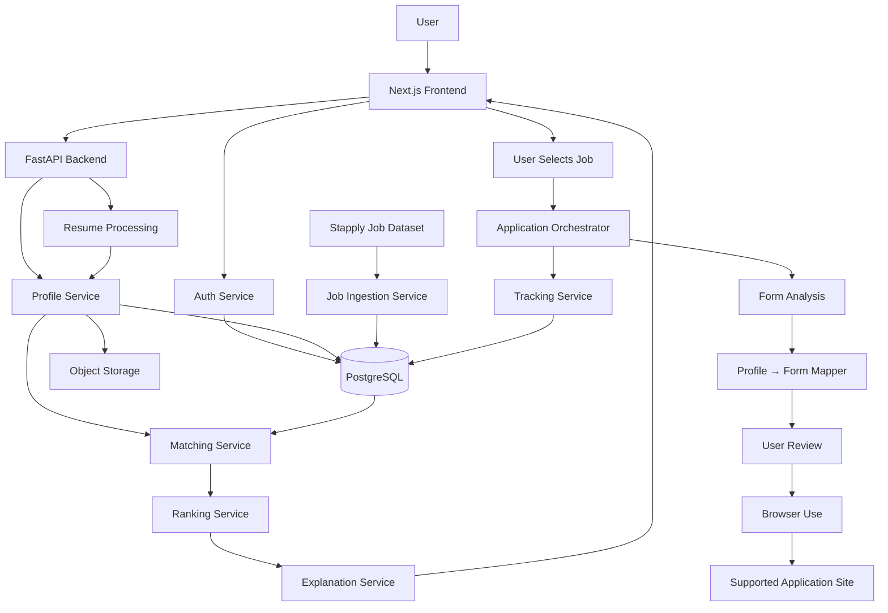

# Turio — System Design

## 1. High-level architecture



## 2. Service boundaries

### Frontend
Responsible for presentation, interaction, state display, and user confirmation.

### Auth service
Responsible for account creation, credential verification, password hashing, and access/refresh token issuance and rotation. See `AUTH.md`.

### FastAPI
Responsible for authenticated API requests, orchestration, validation, and service boundaries. Every route except `/api/v1/auth/*` and `/api/v1/health` requires a valid access token issued by the Auth service.

### Resume service
Responsible for file parsing and candidate-information extraction.

### Job ingestion
Responsible for retrieving/importing source data, normalization, deduplication, and storage.

### Matching service
Responsible for embeddings, similarity, structured matching signals, and score generation.

### Ranking service
Responsible for combining permitted signals into a reproducible ranking.

### Explanation service
Responsible for rendering grounded explanations from stored evidence.

### Application orchestrator
Responsible for the application state machine.

### Browser adapter
Responsible for browser interaction through Browser Use. Website-specific logic must remain outside general application logic.

### Tracking
Responsible for persistent application events/status.

## 3. Data flow

```text
Resume file
→ Parse
→ Candidate profile
→ Database

Job source
→ Normalize
→ Job database

Candidate profile + jobs
→ Embeddings
→ Match signals
→ Ranking
→ Recommendations

Selected job
→ Application form inspection
→ Required-field schema
→ Profile matching
→ Missing-data collection
→ Browser Use
→ Review
→ User-approved submission
→ Tracking
```

## 4. Reliability boundaries

Use asynchronous/background execution for:

- large job ingestion,
- batch embeddings,
- large recommendation refreshes,
- browser tasks that may take time.

Use synchronous requests for:

- profile reads,
- small CRUD operations,
- health checks,
- concise validation.

## 5. External-source isolation

Each external job/application source should implement an adapter interface:

```text
JobSourceAdapter
ApplicationSourceAdapter
```

Do not place site-specific selectors into the generic application logic.

## 6. Recommended repository layout

The following tree is the minimum expected baseline, not an exhaustive future file list.

```text
turio/
├── frontend/
├── backend/
│   ├── app/
│   │   ├── api/
│   │   ├── services/
│   │   ├── models/
│   │   ├── schemas/
│   │   ├── repositories/
│   │   ├── ml/
│   │   ├── agents/
│   │   ├── adapters/
│   │   ├── workers/
│   │   └── core/
│   └── tests/
├── data/
├── experiments/
├── docs/
├── scripts/
├── docker/
├── alembic/
│   └── versions/
├── .env.example
├── .gitignore
├── docker-compose.yml
└── README.md
```
